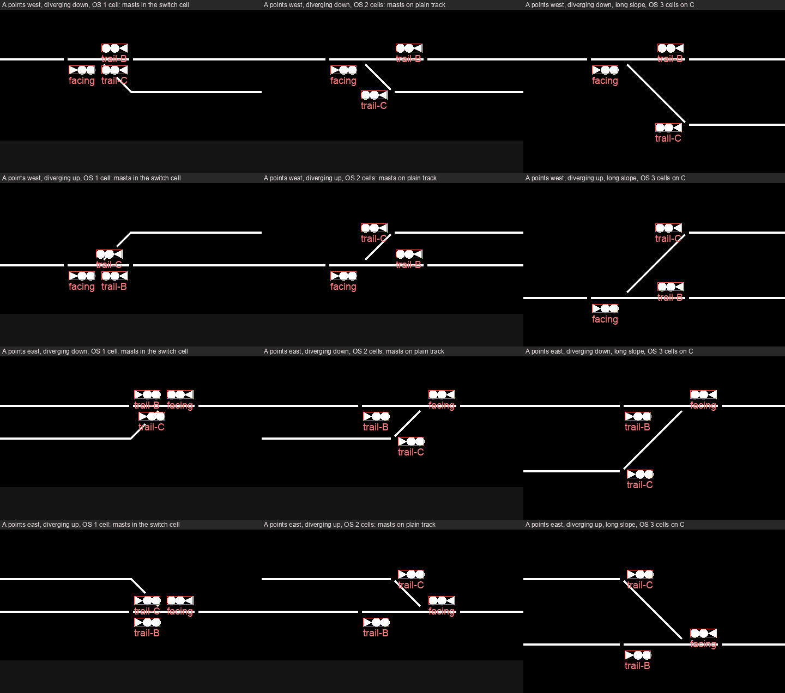
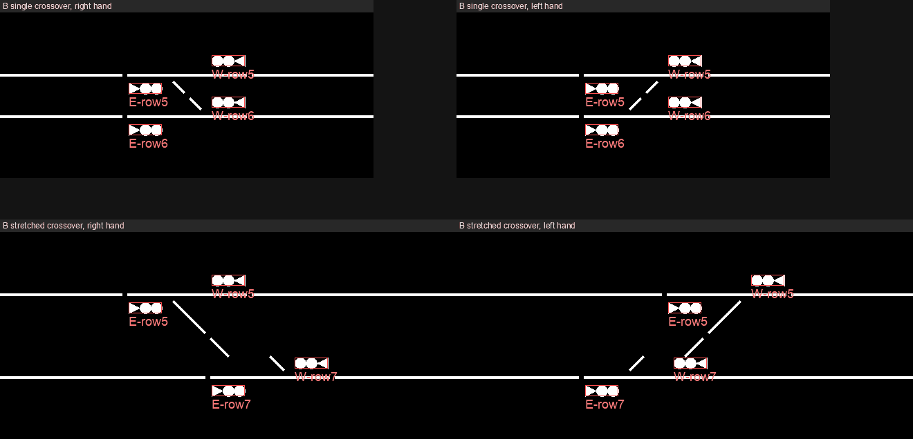

# Where masts read best on a compact CATS panel

On a compact panel (`schematic cats --cells-per-unit 1`) a mast shares a 30 pixel cell with track, switch points and names. This note says where `schematic cats` puts each bound mast's lamps and why, and how it lines up the masts of one control point in a column, like signals on a gantry. The rules came from rendering every turnout and crossover case the way CATS 3.2 draws it and scoring each spot. The code is `spot_costs`, `place_mast` and `shift_gaps` in `schematic/cats.py`.

## What CATS draws

These facts are from the CATS source (`cats/gui/frills/`, `cats/gui/GridTile.java`, `cats/layout/items/PtsEdge.java`, `Section.java`).

- **A mast is drawn in one cell.** Its SECSIGNAL belongs to the edge of the block it protects, so the lamps are always drawn in that block's cell beside the gap. A mast cannot be drawn in the cell next door.
- **The lamps are 8 pixel discs** (`SignalFrill.Radius`), one per head, in a row that points toward SIGORIENT. The base is behind them: a filled 8 pixel triangle pointing at the heads, or a tee when Tee Base is on. The box is (heads + 1) x 8 by 8 pixels, turned when the lamps point up or down. Its size does not change with the grid.
- **SIGLOCATION places the box's corner** (`FrillLoc`). The horizontal codes are `L` = x + 1, `OL` = x + 7, `C` = centred, `OR` = x + 22 - width and `R` = x + 29 - width. The vertical codes work the same way. So in a 30 pixel cell a 3-head box (32 pixels long) always spills into the next cell, and `LOWRIGHT` moves a longer box to the left.
- **Track** is a 2 pixel line between edge midpoints. It stops 2 pixels short of a block boundary (`GridTile.BlockGap`), which is what the dispatcher sees as a gap.
- **Switch points** show only as a 5 pixel break in the unlined route at the points edge (`RailFrill.PointGap`, `PtsEdge.closeOneGap`). Anything drawn there hides which way the points lie.
- **Clicks.** A click in a switch's cell throws it when no frill takes the click first (`GridTile.startMouse`, then `Section.sectionMouse`). A click inside a signal's box sets a route at that signal instead. So a mast in a switch's cell takes part of the area the dispatcher clicks to move the points.

## The rules

Each spot is scored. The command takes the cheapest spot, and ties go to the first one in FrillLoc order.

| Against a spot | Cost | Why |
|---|---|---|
| a track line through a lamp or the base (within 3 px of a disc's middle) | 10 each | the lamp hides the track's colour, and if that track is its own, the gap it guards too (+2) |
| a lamp touching a line (3 to 5 px) | 4 | reads as lying on the rail |
| a line close by (5 to 7.5 px) | 1 | cramped |
| over a switch's points gap (9 px into the cell, 3 px past its edge, 6 px each side of its middle) | 5 | hides the points' position |
| overlapping another mast | 10 | |
| the mast's foot nearer another track than its own | 15 | it would read as that track's mast, which is worse than a crowded lamp |
| not on the right-hand side of the move | 2 | the North American convention, and the live desks |
| lamps not pointing the way the move goes across the screen | 2 on level track, 1 on a slope | up or down suits a slope nearly as well as along it |
| foot distance from the gap's middle | 1 per 15 px | the mast stands at its gap |
| box over the gap, into the block behind | 1 per 2 px | |
| box outside its cell | 1 per 20 px | |

What comes out:

1. **Level track.** The lamps point the way of the move. Going right they sit below the track: `LOWCENT`, or `LOWRIGHT` for one head. Going left they sit above it: `UPCENT`. Both keep the lamps 6 pixels clear of the line. The `LEFTLOW`, `RIGHTLOW`, `LEFTUP` and `RIGHTUP` spots put a lamp on the line, so they are never used on level track.
2. **The end of a slope** (a gap on the left or right edge of a half-diagonal cell). The lamps still point left or right and sit in the open corner of the cell: `LEFTLOW`/`LEFTUP` or `RIGHTLOW`/`RIGHTUP`, on the right-hand side when it is open.
3. **A vertical run** (a turnback). The lamps point up or down beside the run on the move's right-hand side: `RIGHTUP` going up, `LEFTCENT` going down.
4. **Keep masts out of switch cells.** With the OS reaching only into the switch's own cell, the trailing masts land in that cell (first column of the turnouts sheet below). There the diverging-leg mast cannot be clean in any spot, and every such mast takes clicks meant for the points. With the OS one more cell along each leg (second column), every mast is clean. The facing-point mast is never in the switch cell.
5. **A gap mid-slope in a switch's cell.** This is a slope one unit long from switch to switch, where there is no track to move the gap along. No spot is clean. The cheapest has the lamps pointing up the slope (or down it), low, beside the slope, at `LOWLEFT` or the mirror spot. One lamp touches the level track there. Every spot on the move's right-hand side puts a lamp across the slope. Every spot above the level track reads as that track's mast. The only clean fix is a wider column.

## Gantries: one column per control point and direction

Masts of one control point that face one way (the same `control_points` entry in the band's layer 1, else the same switch, and the same `dir`) and stand within a column of each other form a gantry. `shift_gaps` lines them up without adding cells.

- **Gaps move instead of cells being added.** A gap may move up to 3 cells along its own track, level or sloped. It stays between the same two blocks, so the mast still protects the same block, and the panel's blocks, names and bindings are unchanged. A gap never moves onto points or a crossing, and each block keeps at least one cell of the track. A gap that a mast of another gantry also uses stays where it is.
- **The column.** It is the one most masts can reach. Ties go to the column that leaves the fewest masts in switch cells, then to the fewest cells moved. A mast standing alone gets the same treatment, so it moves out of a switch cell when its track allows.
- **The look.** A gantry's masts take one SIGLOCATION when that spot is clean for all of them, chosen so their feet (bases) line up within 2 pixels. Then the eastbound masts stand in one line and the westbound in another.
- **Cost.** No columns are added; the width stays the same. Each move is logged as "mast M: its gap moved N cell(s) along track T". A mast that cannot reach its gantry's column is logged too.

A single crossover between adjacent rows is a gantry already (crossovers sheet, top). A stretched crossover staggers its masts by the length of the slope. Its gaps then move along the through tracks into one column per direction, as the gantry rules above describe.

## Overriding

A mast's `orient` (and `location`) in the bindings still win. With only `orient`, the cheapest spot for that orientation is used. The rules should make such overrides rare. Use one when the owner prefers a different compromise in a spot that cannot be clean.
